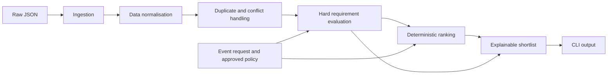

# Proposed Rust CLI architecture

The CLI reads a local JSON file and an explicit event request. A synchronous library evaluates the supplied evidence and returns a report. The report depends on its inputs and documented policy, including any booking reference date. System time, network services and terminal state are outside the core.

## Module boundaries

| Boundary | Responsibility |
| --- | --- |
| `main.rs` | Parse arguments, read the file, call the library, render the report to stdout and write errors to stderr with a suitable exit status. |
| `lib.rs` and `domain` | Coordinate the pipeline. Define the event request, venue facts, evidence states and typed report. |
| `ingest` | Expose file loading and in-memory parsing. Reject unreadable documents, bad JSON and invalid envelopes. Account for every row and give rejected rows and recoverable field issues source references. |
| `normalize` | Convert supported field shapes into typed capacity, price, availability, travel and accessibility evidence. Preserve raw values and source references for unresolved facts. |
| `dedup` | Compare the known identity signals and record confidence and conflicts. Only apply an identity or precedence rule once agreed. |
| `evaluate` | Evaluate each hard requirement against the request and evidence. Record pass, fail or unresolved with a reason. |
| `rank` | Order eligible candidates using documented preferences and return the scoring factors. |
| CLI rendering | Render reasons and warnings from the typed report. Keep formatting in the binary until its size justifies a separate module. |

These are responsibilities. Add physical modules when the implementation needs them. A few passes over a vector and direct comparisons are sufficient for 30 venues.

## Evidence, eligibility and ranking

The [product decision record](requirements.md#working-product-decisions) owns the candidate-approved policy and acceptance cases. The unverified export supports preliminary shortlist eligibility. Route, toilet, quote and slot verification belong to booking readiness.

- Retain the difference between a known fact, missing evidence, invalid evidence and a conflict. Preserve qualifications such as room layout, estimate ranges, access scope, date exceptions and quote basis. Record IDs, field paths and supporting notes where they explain a decision.
- Keep suspected duplicates traceable to both IDs. For a confirmed duplicate, preserve source evidence for disagreeing hard fields. A conflicting or ambiguous value stays unresolved unless an approved precedence rule settles it. Where identity matters to eligibility, flag the candidate for confirmation.
- Evaluate all hard criteria together on each allowed date. Use the scenario verdict rules in PD-007 to combine passing, unresolved and failed dates.
- Compare compatible price evidence using checked minor-unit arithmetic. Preserve quoted amounts, known minimum costs, estimates and unknowns. Apply PD-002 independently at 80 and 120.
- Rank only eligible candidates in the preliminary shortlist. Apply PD-007, including the travel heuristic, quality evidence, comparable budget headroom, expansion verdict and stable ID tie-break. Explicit unacceptable light or Wi-Fi is an eligibility failure. Keep explanations and diagnostic order stable.
- Carry the matched date or date evidence, capacity and breakout fit, accessibility basis, budget basis and ranking factors into the report. Include an empty-result summary with rejection and confirmation counts and representative reasons. The report includes a separately labelled confirmation list and the evidence behind the 120-person expansion verdict.

## Dependencies

TASK-002 uses `chrono` 0.4.45 as its sole direct dependency for validated dates and weekdays, with default features disabled. Integer minor units and standard Rust types cover the other domain invariants. Add dependencies when a feature uses them and verify the selected versions against the supported Rust toolchain.

| Crate | Recommendation and rationale |
| --- | --- |
| `serde_json` | Selected for the heterogeneous JSON envelope and fields. `arbitrary_precision` preserves decimal number text for checked conversion to integer minor units. [Documentation](https://docs.rs/serde_json/latest/serde_json/) |
| `serde` | Add directly if deriving types for the stable document envelope, request or machine-readable report. The initial ingestion uses `serde_json::Value` and omits a direct Serde dependency. [Documentation](https://serde.rs/) |
| `clap` | Add when the approved CLI has multiple flags or typed inputs requiring consistent help and validation. A single optional path can use `std::env::args_os`. [Documentation](https://docs.rs/clap/latest/clap/) |
| `chrono` | Selected for `NaiveDate` and `Weekday` in the request and availability evidence. Pure calendar dates need no clock or timezone features. [Documentation](https://docs.rs/chrono/latest/chrono/struct.NaiveDate.html) |
| `rust_decimal` | Defer while checked integer minor units cover amounts such as €72.50 and integer attendee multiplication. Revisit if fractional tax, FX or another approved calculation needs decimal arithmetic and explicit rounding. [Documentation](https://docs.rs/rust_decimal/latest/rust_decimal/) |
| `thiserror` | Defer. A small library error enum can implement `Display` and `Error` directly. Consider the derive if several wrapper variants need consistent sources. [Documentation](https://docs.rs/thiserror/latest/thiserror/) |
| `anyhow` | Defer. Add CLI context through explicit messages and standard errors. Consider it at the binary boundary if contextual error plumbing grows. [Documentation](https://docs.rs/anyhow/latest/anyhow/) |

## Focused test plan

| Test area | Cases and expected behaviour |
| --- | --- |
| Ingestion and missing fields | Malformed JSON and wrong top-level shape fail with context. Missing, null, type-mismatched, and valid zero or false values remain distinct as appropriate. A recoverable issue identifies the record and path. |
| Capacity and breakouts | Integers, v002's range, v004's layout-specific object, v017's seated versus standing text, v027's invalid zero, qualified and ranged breakout counts. Verify boundary cases for 80 and 120 and for three or four rooms under the agreed policy. |
| Pricing and budget | Per-day, per-person decimal, part-day text, grouped strings, on-request and null prices, minimum spend, EUR versus USD, inclusive and exclusive VAT, mandatory catering. Verify exact-cap, over-cap and incomplete total scenarios using the approved rounding and inclusion rules. |
| Duplicates and conflicts | Use the three observed pairs and a similar-name negative case. Retain both source IDs, distinguish a possible distinct room from a proven match, and verify that conflicts cannot create eligibility by merging stronger claims. |
| Accessibility | A positive flag with no contrary evidence supports preliminary eligibility. Cover known inaccessible required rooms, partial, conflicting, missing and unknown states, and carry access verification to booking. |
| Dates | Cover exact dates, weekday patterns, omitted years, the March 18 exception, booking lead time, an explicit closure and an unknown answer. Verify Thursday preference when Tuesday also satisfies the accepted window. |
| Hard requirements | A failed hard rule overrides an otherwise excellent fit and any unresolved rule. An unknown hard requirement cannot enter the confirmed shortlist. Verify an empty shortlist and confirmed/follow-up counts. |
| Ranking and output | Exercise ties, repeat calls and permuted records with stable IDs. A small end-to-end fixture verifies report order, reasons, source IDs, warnings, stdout/stderr and exit status. Run the final documented command against the original dataset, including the v019 80/120 regression and equivalent synthetic evidence (AC-15). |

## Implementation and review sequence

Use the [backlog and review checkpoints](tasks/README.md#engineering-review-checkpoints). Review the domain before ingestion (R1), data processing after deduplication (R2), hard rules and ranking after TASK-006 (R3), and the complete pipeline after end-to-end validation (R4, TASK-009). Verify each checkpoint against actual diffs, tests, business decisions, architecture and history. Keep findings and verified corrections in the assessment log.

The native CLI is the primary deliverable. [TASK-007B](tasks/TASK-007B-docker-packaging.md) can add a local container after the CLI and before end-to-end validation. The same external input and CLI arguments apply, and the native workflow has no Docker dependency.
