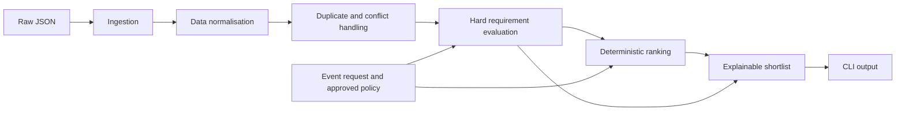

# Proposed Rust CLI architecture

The CLI reads a local JSON file and an explicit event request. A synchronous library evaluates the supplied evidence and returns a report. The report depends on its inputs and documented policy, including any booking reference date or supplied exchange rate. System time, network services and terminal state are outside the core.

## Module boundaries

| Boundary | Responsibility |
| --- | --- |
| `main.rs` | Parse arguments, read the file, call the library, render the report to stdout and write errors to stderr with a suitable exit status. |
| `lib.rs` and `domain` | Coordinate the pipeline. Define the event request, venue facts, evidence states and typed report. |
| `ingest` | Validate the JSON envelope and enumerate records with source references. Fatal document errors stop the run. A recoverable record or field problem produces a diagnostic with an ID or index and its field path. |
| `normalize` | Convert supported field shapes into typed capacity, price, availability, travel and accessibility evidence. Preserve raw values and source references for unresolved facts. |
| `dedup` | Compare the known identity signals and record confidence and conflicts. Only apply an identity or precedence rule once agreed. |
| `evaluate` | Evaluate each hard requirement against the request and evidence. Record pass, fail or unresolved with a reason. |
| `rank` | Order eligible candidates using documented preferences and return the scoring factors. |
| CLI rendering | Render reasons and warnings from the typed report. Keep formatting in the binary until its size justifies a separate module. |

These are responsibilities. Add physical modules when the implementation needs them. A few passes over a vector and direct comparisons are sufficient for 30 venues.

## Evidence, eligibility and ranking

- Retain the difference between a known fact, missing evidence, invalid evidence and a conflict. Preserve qualifications such as room layout, estimate ranges, access scope, date exceptions and quote basis. Record IDs, field paths and supporting notes where they explain a decision.
- Keep suspected duplicates traceable to both IDs. For a confirmed duplicate, preserve source evidence for disagreeing hard fields. A conflicting or ambiguous value stays unresolved unless an approved precedence rule settles it. Where identity matters to eligibility, flag the candidate for confirmation.
- Use `Rejected` when at least one hard criterion fails. Use `RequiresConfirmation` when none fail and one or more remain unresolved. Use `Eligible` when all pass. One eligible date can satisfy an approved set of acceptable dates only if the relevant room, booking and other hard criteria also apply to that date.
- Proposed budget comparison uses checked arithmetic and a compatible currency and price basis. Account for the agreed minimum-spend rule, applicable VAT and required extras. A known lower bound above a firm cap can establish failure. An incomplete quote within the cap leaves the total unresolved.
- Rank only eligible candidates in the confirmed shortlist. Use a documented order of approved factors, such as suitable Thursday dates, rail access and room or amenity fit. Use a stable source ID or canonical group ID as the final tie-break. Compare cost only where meaningful. Keep score explanations and diagnostic order stable.
- Carry the matched date or date evidence, capacity and breakout fit, accessibility basis, budget basis and ranking factors into the report. Include an empty-result summary with rejection and confirmation counts and representative reasons. A separately labelled confirmation list is a product option.

## Dependencies

Phase 1 uses the standard library. Add dependencies when a feature uses them and verify the selected versions against the supported Rust toolchain.

| Crate | Recommendation and rationale |
| --- | --- |
| `serde_json` | Add for ingestion. It parses JSON and supports inspecting heterogeneous field values with `Value`. Retain exact decimal text or use appropriate parser settings for money before converting to minor units. [Documentation](https://docs.rs/serde_json/latest/serde_json/) |
| `serde` | Add directly if deriving types for the stable document envelope, request or machine-readable report. Initial ingestion using only `serde_json::Value` can omit the direct dependency. [Documentation](https://serde.rs/) |
| `clap` | Add when the approved CLI has multiple flags or typed inputs requiring consistent help and validation. A single optional path can use `std::env::args_os`. [Documentation](https://docs.rs/clap/latest/clap/) |
| `chrono` | Recommend `NaiveDate` when validating dates and weekdays, handling exceptions and checking lead times. Pure calendar dates need no clock or timezone features. [Documentation](https://docs.rs/chrono/latest/chrono/struct.NaiveDate.html) |
| `rust_decimal` | Defer while checked integer minor units cover amounts such as €72.50 and integer attendee multiplication. Revisit if fractional tax, FX or another approved calculation needs decimal arithmetic and explicit rounding. [Documentation](https://docs.rs/rust_decimal/latest/rust_decimal/) |
| `thiserror` | Defer. A small library error enum can implement `Display` and `Error` directly. Consider the derive if several wrapper variants need consistent sources. [Documentation](https://docs.rs/thiserror/latest/thiserror/) |
| `anyhow` | Defer. Add CLI context through explicit messages and standard errors. Consider it at the binary boundary if contextual error plumbing grows. [Documentation](https://docs.rs/anyhow/latest/anyhow/) |

## Focused test plan

| Test area | Cases and expected behaviour |
| --- | --- |
| Ingestion and missing fields | Malformed JSON and wrong top-level shape fail with context. Missing, null, type-mismatched, and valid zero or false values remain distinct as appropriate. A recoverable issue identifies the record and path. |
| Capacity and breakouts | Integers, v002's range, v004's layout-specific object, v017's seated versus standing text, v027's invalid zero, qualified and ranged breakout counts. Verify boundary cases for 80 and 120 and for three or four rooms under the agreed policy. |
| Pricing and budget | Per-day, per-person decimal, part-day text, grouped strings, on-request and null prices, minimum spend, EUR versus USD, inclusive and exclusive VAT, mandatory catering. Verify exact-cap, over-cap and incomplete total scenarios using the approved rounding and inclusion rules. |
| Duplicates and conflicts | Use the three observed pairs and a similar-name negative case. Retain both source IDs, distinguish a possible distinct room from a proven match, and verify that conflicts cannot create eligibility by merging stronger claims. |
| Accessibility | Cover true, false, ground-floor-only, room-specific exclusion, undefined upper-floor access and unknown. Evaluate against the required spaces rather than a venue-wide boolean alone. |
| Dates | Cover exact dates, weekday patterns, omitted years, the March 18 exception, booking lead time, an explicit closure and an unknown answer. Verify Thursday preference when Tuesday also satisfies the accepted window. |
| Hard requirements | A failed hard rule overrides an otherwise excellent fit and any unresolved rule. An unknown hard requirement cannot enter the confirmed shortlist. Verify an empty shortlist and confirmed/follow-up counts. |
| Ranking and output | Exercise ties, repeat calls and permuted records with stable IDs. A small end-to-end fixture verifies report order, reasons, source IDs, warnings, stdout/stderr and exit status. Run the final documented command against the original dataset as a smoke check. |

## Proposed implementation sequence

1. Record the product decisions and Claude Code plan. Define the request, evidence types and one end-to-end fixture.
2. Implement JSON ingestion and the observed normalisation cases. Add focused tests for evidence and diagnostics.
3. Handle duplicate candidates and conflicts, then implement hard checks for the agreed event policy.
4. Add ranking, explanations and CLI output. Document the local command and verify it with the unmodified dataset.
5. Review actual diffs, steer fixes, rerun the checks and complete the review section in `NOTES.md`. Commit each coherent change and keep the planning artifacts.
