# AplanIQ Venue Shortlist implementation backlog

This is the implementation backlog. It is based on both pages of the original assessment, the supplied `venues.json` and the Phase 1 [requirements](../requirements.md), [architecture](../architecture.md) and [data audit](../data-analysis.md). TASK-001 is complete with candidate-approved working assumptions. TASK-002 is complete. R1 passed. TASK-003 and TASK-004 are complete. R2 initially returned **NO-GO**. The [P0 data-integrity corrections](../engineering/standards-audit.md#findings) cleared the gate. TASK-005 and TASK-006 are complete. [R3 returned NO-GO](../engineering/r3-business-logic-review.md). Correct R3-001 before TASK-007.

## Backlog and execution order

| Task | Deliverable | Direct dependencies | Estimate |
| --- | --- | --- | --- |
| [TASK-001](TASK-001-requirements.md) | Requirements, product decisions and reference event scenario | None | 12 min original estimate |
| [TASK-002](TASK-002-domain-model.md) | Rust domain, evidence, error and report types | 001 | 8 min |
| [TASK-003](TASK-003-normalisation.md) | JSON ingestion and normalisation of observed shapes | 002, R1 | 30 min |
| [TASK-004](TASK-004-deduplication.md) | Conservative duplicate handling and conflicting evidence | 003 | 10 min |
| [TASK-005](TASK-005-eligibility.md) | Hard requirements and criterion-level results | 003, 004, R2 | 27 min |
| [TASK-006](TASK-006-ranking.md) | Deterministic ranking and recommendation reasons | 005 | 9 min |
| [TASK-007](TASK-007-cli.md) | Local CLI, report and first documented invocation | 006, R3 | 13 min |
| [TASK-007B](TASK-007B-docker-packaging.md) | Optional local container packaging | 007 | 10 min optional |
| [TASK-008](TASK-008-validation.md) | Integration and original-dataset validation | 007 | 12 min |
| [TASK-009](TASK-009-code-review.md) | R4 final independent review and targeted fixes | 008 | 12 min |
| [TASK-010](TASK-010-submission.md) | Final checks and private-submission handoff | 009 | 8 min |

```mermaid
flowchart LR
    T001["001 Requirements"] --> T002["002 Domain"]
    T002 --> R1["R1 Architecture and domain"] --> T003["003 Normalisation"]
    T003 --> T004["004 Deduplication"]
    T003 --> T005["005 Eligibility"]
    T004 --> R2["R2 Data processing"] --> T005
    T005 --> T006["006 Ranking"]
    T006 --> R3["R3 Business logic and ranking"] --> T007["007 CLI"]
    T007 --> T008["008 Validation"]
    T007 -.-> T007B["007B Optional Docker"] -.-> T008
    T008 --> T009["009 / R4 Final independent review"]
    T009 --> T010["010 Submission"]
```

Follow numerical order for completed deliverables. Once TASK-001 defines the scenario and policies, the integration fixture and expected results can be drafted alongside the core work. Once the report contract is agreed, CLI argument and rendering tests can be drafted before the full pipeline is wired. Complete and verify each task after its dependencies. If time permits, schedule TASK-007B between TASK-007 and TASK-008. Native validation can proceed without TASK-007B.

## Engineering review checkpoints

The [Rust engineering standards](../engineering/rust-standards.md) and [quality gate](../engineering/quality-gates.md) apply to every implementation task and major review. Task-specific commands supplement those gates.

| Checkpoint | When | Review focus |
| --- | --- | --- |
| R1 | After TASK-002 and before TASK-003 | Architecture, domain evidence, precision and invariants |
| R2 | After TASK-004 and before TASK-005 | Ingestion, record accounting, evidence preservation and identity handling |
| R3 | After TASK-006 and before TASK-007 | Hard rules, policy traceability, ranking and regression tests |
| R4 | After TASK-008, as TASK-009 | Independent review of end-to-end behaviour and readiness |

At each checkpoint inspect actual source, tests and results, applicable business rules, architecture, recent diffs and Git history. Run the relevant gates. Record severity, file and line, evidence, impact, correction and test result in the [assessment log](../assessment-log.md). Commit verified corrections separately. R4 uses TASK-009's independent review, with no duplicate task.

## Assessment traceability

| Assessment requirement | Owning tasks | Evidence at handoff |
| --- | --- | --- |
| Given an event request, recommend a ranked shortlist meeting the client's hard requirements | 001, 005, 006, 008 | Approved policy and request, tested rejection and confirmation, deterministic ranks with explanations |
| Small Rust CLI or library with tests, using the supplied messy data | 002, 003, 004, 007, 008 | Runnable Rust entry point, unchanged source data, tests for irregular fields, near-duplicates and contradictions |
| Run locally with one documented command and pass `cargo test` | 007, 008, 010 | README invocation and recorded test and smoke results |
| `NOTES.md` is at most two pages, with Spec and assumptions, Product decisions and Review | 001, 009, 010 | Client facts, assumptions, proposed questions and exclusions, at least three decisions with alternatives and rationale, observed findings, steering and strongest diff |
| Let agents write implementation, use Claude Code, prefer GSD or use another harness, and disclose any small hand edits | 002–008, 009, 010 | Actual agent and harness record, diff review and disclosed manual edits if any |
| Commit the actual agent planning artifacts and retain genuine history, including dead ends | 001–010 | Tracked planning artifacts, task evidence, actual attempts and follow-up commits |
| Work at most three hours in one or two sittings within one week. At the limit, stop and log approximate time and next steps | 001–010, finalised in 010 | Dated assessment log and concise notes on unfinished work |
| Questions are optional, with up to three questions to Joa by email. Log assumptions for unanswered points | 001 | At most three selected questions and attributed answers if sent, plus numbered assumptions when facts are unavailable |
| Exclude UI, API, auth, deployment, AWS and real databases | 002, 007, 009, 010 | Local-file scope checked in code and final review |
| Submit a private repository link shared with Joa, containing code, notes and agent artifacts | 010 | Private link and verified recipient access after user authorisation |

## Open decisions and delivery risks

- Use [PD-001–007 and AC-01–15](../requirements.md). The export is unverified. Keep provisional eligibility separate from booking readiness. A controlled fixture and the v019 regression demonstrate the intended shortlist behaviour.
- The PDF requires Claude Code. Earlier business implementation used Codex at the candidate’s direction. That deviation is documented in the assessment log. No GSD planning directory existed at the planning handoff. The final push and sharing are a separate external milestone and are outside this planning run.

## Boundaries and time budget

TASK-003 parses evidence, TASK-004 handles identity and conflicts, TASK-005 decides eligibility and TASK-006 ranks confirmed candidates. TASK-007 renders what the core decided. Test each implementation task as it lands. TASK-008 checks the assembled path and the real input. TASK-009 reviews observed code and test evidence. TASK-010 assembles and verifies the final delivery.

The tasks cover the assessment without a separate dependency-selection milestone, duplicate testing project or infrastructure work. Remaining delivery work includes the executable feature, verified review and authorised delivery. Record actual agent planning and implementation history. The PDF’s Claude Code requirement remains a documented deviation.

The original active-work estimate is **141 minutes**, including **109 minutes** for TASK-002–008 implementation and validation. TASK-004–010 total 91 estimated minutes after TASK-003, before optional packaging. The first recorded Phase 1 check through final verification took **3 minutes 59 seconds**. Count Phase 2, TASK-001 and any other assessment work against the same 180-minute cap. See the [assessment log](../assessment-log.md) for measured intervals. Protect the last 20 minutes for review and final verification, already included in the 141-minute estimate. If pressure increases, reduce parser breadth for undocumented formats, cosmetic output work and optional follow-up display. Protect the working command, hard filters, ranked results, focused tests and honest notes. At the limit, stop and record what remains.

## Agent workflow

Before starting a task, read it and its dependencies, inspect the current code, confirm scope and acceptance criteria, and write a focused plan. Record the actual implementing agent and add relevant tests. Use Claude Code for business implementation and corrections. Codex may audit, plan and enforce engineering standards. Run the listed checks, examine the actual diff and acceptance evidence, and correct observed issues. Record the test results, references and task status in the assessment log and active plan. Mark a task complete only when its acceptance evidence exists.

Use these task IDs and links in agent planning. If GSD is chosen, import or reference this backlog when creating the genuine plan. Maintain execution status in that plan once adopted. Until then, maintain status in the individual task files and link to the assessment log for evidence. Record the selected plan location so there is one source for live status. Commit the actual artifacts emitted by the selected workflow.

Commit each meaningful, coherent local change. Review `git status` and the staged diff, run relevant checks, and keep unrelated staged changes out of the commit. Retain failed attempts and their corrections in the log and any existing commits. Verify against the actual diff and test output before recording completion.
